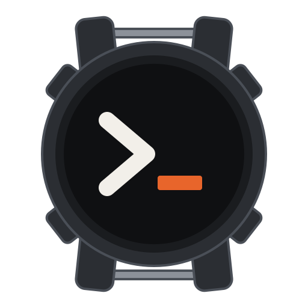
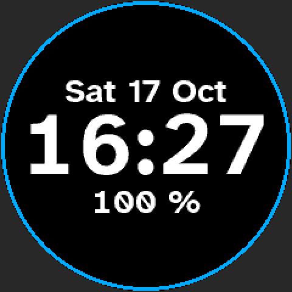

<p align="center">
  
</p>

# wrist-rs

Open-source Rust firmware for the UNA Watch: it shows the time, updates itself over USB,
and steps aside whenever you want the stock firmware back.

> [!IMPORTANT]
> wrist-rs is an independent project, not affiliated with or endorsed by UNA. Please don't
> contact UNA support about problems with it; [open an issue](https://github.com/tobymurray/wrist-rs/issues)
> here instead.

Installing replaces the watch's kernel, at your own risk. The installer runs only on the
stock firmware version named at the top of the [release notes](release/NOTES.md); a newer
stock version is not supported until they name it.

**[Download](https://tobymurray.github.io/wrist-rs/)** ·
[Releases](https://github.com/tobymurray/wrist-rs/releases) ·
[Install guide](release/INSTALL.md)



## What it does

- Shows the time, the day and date, and the battery's charge.
- Lights the face when you press a button; Up and Down step to the battery and about pages.
- Keeps time through restarts and updates; [`tools/wrist-time.py`](tools/wrist-time.py) sets it from your computer,
  with the next daylight-saving changes.
- Installs updates over USB into a second slot, and goes back to the previous version if
  the watch restarts before the new one has run a while with the computer connected.
- Turns off everything the face doesn't use, and sleeps on battery.
- Optionally, in a build with the `ble` feature: the console and updates over Bluetooth, for a
  computer it is bonded to. The radio stays off until you turn it on ([BUILDING.md](BUILDING.md#bluetooth)).
  The same build reads other Bluetooth LE devices, a heart-rate strap among them, and can
  pass a strap's heart rate on to a rower or a bike as a heart-rate sensor of its own.
- Never writes UNA's bootloader code, so the stock firmware is always one recovery away.
  The installer records its outcome in a blank page at the end of the bootloader's partition.

It runs on the watch's STM32U5A5, is built on [Embassy](https://embassy.dev), and needs the
original modules and LS012 display.

## Install, update and recover

[release/INSTALL.md](release/INSTALL.md) installs wrist-rs from the stock firmware, updates
it, and takes the watch back to stock.

## Build

```sh
cd apps/standalone-boot
cargo build --release
```

[BUILDING.md](BUILDING.md) covers the rest, [CONTRIBUTING.md](CONTRIBUTING.md) the rules a
change follows, and [HARDWARE.md](HARDWARE.md) what the firmware relies on about the board.

## License

AGPL-3.0-or-later; see [LICENSE](LICENSE). The vendored Embassy crates keep MIT OR
Apache-2.0, and the other notices are in [release/NOTICES.md](release/NOTICES.md).
