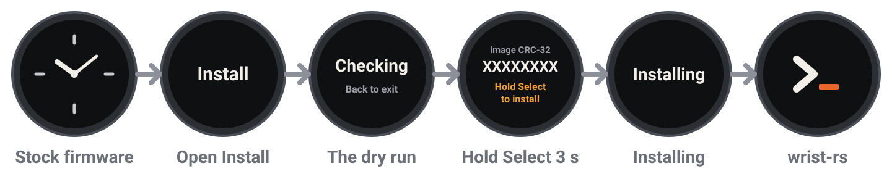
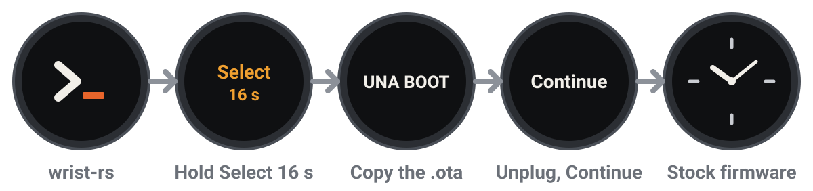

# Start here

This guide puts wrist-rs on a watch running stock firmware, updates it, and takes the watch
back to stock. The [release notes](NOTES.md) say which stock version it needs and what this
build has been checked to do.

## Before you start

You need:

- A UNA Watch with its original modules and LS012 display, running **the stock firmware
  version the [release notes](NOTES.md) name**, charged above 50 %.
- A USB-C **data** cable, and a Linux or macOS computer with Python 3.10 or newer.
- That stock version's `.ota` file, for the way back (below).

**Run the installer only on the stock version the release notes name**, not even its dry
run on another version: the dry run already erases and programs a page of flash that other
versions may use. Putting that version over a newer stock firmware through the recovery
below has not been tried.

Back up the whole of the watch's USB drive, and export what the stock apps can: going back
to stock is not promised to keep your data.

Download the `.ota` **before installing**: from UNA's
[releases](https://github.com/UNAWatch/una-sdk/releases), the one for the version the
watch runs now. Check its SHA-256 against the one that page shows, and stop if any digit
differs:

```sh
sha256sum UnaWatch-Kernel_VERSION.ota        # macOS: shasum -a 256 UnaWatch-Kernel_VERSION.ota
```

Check the download too: in the folder holding the zips and `SHA256SUMS`,
`sha256sum -c SHA256SUMS` (macOS: `shasum -a 256 -c SHA256SUMS`), and once more inside
the extracted package. `gh attestation verify wrist-rs-VERSION.zip --repo
tobymurray/wrist-rs` shows which workflow and commit built it.

## Stock to wrist-rs



1. Connect the data cable. Stock firmware shows the watch's storage as a USB drive (not
   `UNA BOOT`, which is the recovery's drive).
2. In `Apps/ImageInstaller/` on the watch, back up and then remove any `ARM_INSTALL`, older
   `Install_*.uapp` and old logs. Copy the **Install** glance, the package's
   `first-install/Apps/ImageInstaller/`, into it: exactly `Install_VERSION.uapp` and
   `image.bin`, and no `ARM_INSTALL`. Neither `app.bin` nor `image.bin` is an `.ota`.
3. Eject the drive safely, unplug, and restart the watch: stock finds a newly copied
   glance only when it starts. Then open the glance carousel on battery. Stock starts
   **every** glance service together, so opening the carousel runs the installer's dry
   run whether or not its tile is in view.
4. Find **Install**. It should read `ready XXXXXXXX`, the digits in `INSTALL-CRC.txt`.
   Plug in and copy `Apps/ImageInstaller/install.log` to your computer. Check it against
   `manifest.json`: the CRC and size, a plan within bank 1 pages 48 to 115, staging in
   bank 2 pages 128 to 195, a successful unlock and flash self-test, and no refusal. If
   the log is missing, anything mismatches, or it refused: stop, remove the installer's
   files from the watch, and keep the logs.
5. Only once the dry run is right, create the arm file **on the watch**, beside
   `image.bin`. From the extracted package, with `WATCH` set to where the watch's drive is
   mounted:

   ```sh
   WATCH="/run/media/$USER/<drive>"    # macOS: WATCH="/Volumes/<drive>"
   cp INSTALL-CRC.txt "$WATCH/Apps/ImageInstaller/ARM_INSTALL"
   ```

   It must hold exactly this build's eight hex digits. **Creating this file is the
   decision**: the next time the carousel starts, the installer installs. Eject safely,
   unplug, and open the carousel when you are ready.
6. The Install tile freezes for a second or so while it stages the image, the backlight
   flashes, and the watch restarts into wrist-rs. Do not interrupt its power. `refused -N`
   means the stock firmware was not replaced: plug in, save `install.log` and
   `stage.log`, remove `ARM_INSTALL`, and stop. If no face appears after a few minutes, go back to stock
   (below).
7. Plug the cable back in. wrist-rs is a serial console, not a USB drive. Set up the tools
   (next), run `.venv/bin/python tools/wrist-cmd.py "boot;version"` until `boot` says
   **`state boot`**, check that the build is `manifest.json`'s `build_id`, and set the
   time.

## The tools

On Linux, let your user open the watch's port, and keep ModemManager off it:

```sh
sudo cp tools/60-wrist-rs.rules /etc/udev/rules.d/
sudo udevadm control --reload && sudo udevadm trigger
```

On macOS, allow the accessory when asked. Then, on either:

```sh
python3 -m venv .venv
.venv/bin/python -m pip install -r tools/requirements.txt
.venv/bin/python tools/wrist-time.py                   # sets the watch to this computer's time and zone
.venv/bin/python tools/wrist-cmd.py "boot;version"     # any console command; "help" lists them
```

`wrist-time.py` sends the local time and the zone's next two daylight-saving changes, which
the watch applies by itself. Run it again within a year, after a move to another zone, and
after a 16-second hold of Select, which clears the zone with the clock. `wrist-time.py
--print` shows what it would send, without a watch.

The tools find the watch by its USB ID, 1209:d1a1, which is requested from pid.codes and
not yet assigned, so it may change in a later release. `--port` names the port instead
(`/dev/ttyACM0` on Linux, `/dev/cu.usbmodem*` on macOS). Close any other program using the
port first.

## Updating

```sh
.venv/bin/python tools/wrist-update.py app.bin
```

The tool checks the transfer's CRC, has the watch write its second slot and restart into
it, then waits for **`state boot`**. A failure before the restart leaves the current
version. After it, the new version is kept once it has run a while with the computer
connected; a restart before then brings the previous one back. Check `boot` and `version`
before trying again, rather than restarting a new version repeatedly.

The loader is separate, and only when the release notes ask for it:
`.venv/bin/python tools/wrist-update.py --loader loader.bin`. It has no second slot, so a
power cut while it is written needs the recovery below. Keep the cable in, and check
`boot;version` afterwards.

If the watch reports a crash, `power` shows its record, and [`tools/wrist-crash.py`](../tools/wrist-crash.py)
decodes it with this exact `app.bin`; keep the debug zip and `manifest.json` with any
report.

## Back to stock, and out of any failure



1. Have the checked `.ota` and your backup ready. Hold **Select** for about 16 seconds,
   which resets the watch's power, and keep holding until the bootloader's USB screen.
   Connect the data cable: a drive called **`UNA BOOT`** appears.
2. Copy the `.ota` to the root of `UNA BOOT`, eject it safely, and unplug the cable: the
   menu takes **Continue** only once it is out. Choose **Continue**, which installs the file
   it finds, on battery. If the drive does not appear, try the hold again with a cable and
   port you know carry data. If the file is refused, check its source, size and SHA-256
   again.
3. Stock starts and reports its version. Compare apps, settings and data with your backup.
   Remove any leftover `ARM_INSTALL` before opening the carousel again.

The long hold clears the watch's clock. **Factory Reset** is not this: it returns the watch
to its original firmware, losing every release since. Do not use it for recovery.
